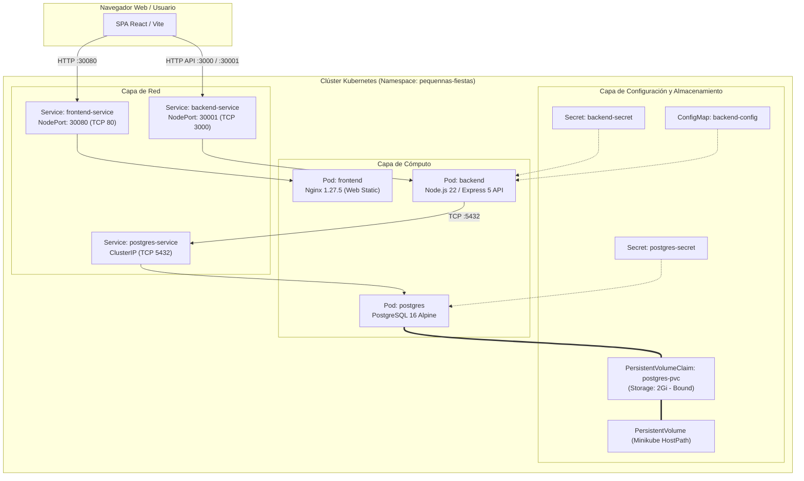
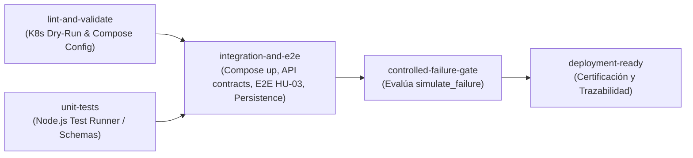

# Pequeñas Fiestas (GigaShow) — Manual Maestro DevOps y Guía de Defensa

Guía técnica integral de infraestructura, integración continua, pruebas automatizadas, despliegue en Kubernetes (Minikube) y sustentación académica frente a la rúbrica de evaluación de la entrega final DevOps.

---

## Índice General

1. [Resumen del Proyecto y Propuesta de Valor](#1-resumen-del-proyecto-y-propuesta-de-valor)
2. [Arquitectura Técnica del Sistema](#2-arquitectura-técnica-del-sistema)
3. [Instalación y Guía de Despliegue Local](#3-instalación-y-guía-de-despliegue-local)
4. [Gestión Segura de Variables y Secretos](#4-gestión-segura-de-variables-y-secretos)
5. [Docker e Imágenes Publicadas en DockerHub](#5-docker-e-imágenes-publicadas-en-dockerhub)
6. [Pipeline de Integración Continua (GitHub Actions)](#6-pipeline-de-integración-continua-github-actions)
7. [Matriz de Pruebas Automatizadas](#7-matriz-de-pruebas-automatizadas)
8. [Operación y Despliegue en Kubernetes (Minikube)](#8-operación-y-despliegue-en-kubernetes-minikube)
9. [Persistencia de Datos en PostgreSQL](#9-persistencia-de-datos-en-postgresql)
10. [Observabilidad, Diagnóstico y Manejo de Incidentes](#10-observabilidad-diagnóstico-y-manejo-de-incidentes)
11. [Trazabilidad de Entrega, CD y Frontera GitOps](#11-trazabilidad-de-entrega-cd-y-frontera-gitops)
12. [Matriz de Cumplimiento de la Rúbrica Oficial (P1–P4 y D1–D9)](#12-matriz-de-cumplimiento-de-la-rúbrica-oficial-p1p4-y-d1d9)
13. [Guion Cronometrado para la Defensa Técnica](#13-guion-cronometrado-para-la-defensa-técnica)
14. [Banco de Preguntas Técnicas del Docente](#14-banco-de-preguntas-técnicas-del-docente)
15. [Limitaciones Conocidas y Deuda Técnica](#15-limitaciones-conocidas-y-deuda-técnica)

---

## 1. Resumen del Proyecto y Propuesta de Valor

### 1.1. Qué es GigaShow / Pequeñas Fiestas
**GigaShow** es una plataforma web orientada al mercado de entretenimiento y eventos sociales. Su propósito es conectar de manera directa y transparente a organizadores de eventos (clientes) con artistas profesionales (músicos, comediantes, animadores), eliminando intermediarios costosos, estafas y cancelaciones imprevistas.

### 1.2. Problema Real que Resuelve
- **Para los clientes:** La contratación informal de artistas suele carecer de garantías de puntualidad, verificación de trayectoria y claridad en tarifas acordadas.
- **Para los artistas:** Dificultad para visibilizar su trabajo, gestionar su agenda de disponibilidad, pactar honorarios justos y protegerse contra cancelaciones de último momento sin retribución.
- **Solución implementada:** Un sistema integral con catálogo de perfiles profesionales, gestión automatizada de solicitudes de reserva (HU-03), historial de contrataciones y autenticación basada en sesiones seguras.

### 1.3. Alcance de la Infraestructura DevOps
El repositorio principal orquesta la entrega completa del sistema desacoplado mediante dos modalidades:
1. **Ambiente de desarrollo local rápido:** Orquestado con **Docker Compose** para iteración ágil y ejecución de suites de pruebas locales.
2. **Ambiente de producción/evaluación contenerizado:** Desplegado sobre **Kubernetes en Minikube**, con aislamiento de red mediante `Namespace`, control declarativo de réplicas (`Deployments`), enrutamiento balanceado (`Services`), persistencia de datos desacoplada (`PersistentVolumeClaim`) y gestión externa de secretos (`Secrets`).



---

## 2. Arquitectura Técnica del Sistema

### 2.1. Componentes del Monorepo de Infraestructura
- **docker-compose.yml:** Define los servicios `database`, `backend` y `frontend` con healthchecks activos, dependencias saludables y variables de entorno parametrizadas.
- **db/init.sql:** Esquema DDL inicial para PostgreSQL (7 tablas: `user`, `session`, `account`, `verification`, `artist_profiles`, `bookings`, `artist_ratings`).
- **k8s/:** Manifiestos declarativos de Kubernetes:
  - `namespace.yaml`: Aislamiento en el namespace `pequennas-fiestas`.
  - `postgres-pvc.yaml`: Solicitud de volumen persistente de 2Gi con modo `ReadWriteOnce`.
  - `postgres-init-configmap.yaml`: Almacena el SQL de inicialización montado en `/docker-entrypoint-initdb.d`.
  - `postgres-deployment.yaml`: Despliegue con estrategia `Recreate` para evitar escrituras concurrentes en el volumen.
  - `postgres-service.yaml`: Servicio interno `ClusterIP` que expone el puerto `5432`.
  - `backend-configmap.yaml`: Variables no confidenciales (`NODE_ENV`, `PORT`, `FRONTEND_ORIGIN`, `BACKEND_URL`).
  - `backend-deployment.yaml`: Despliegue del backend con liveness (`/health`) y readiness probes (`/health/db`).
  - `backend-service.yaml`: Servicio `NodePort` en puerto `30001` (puerto destino `3000`).
  - `frontend-deployment.yaml`: Despliegue Nginx con liveness y readiness probes en `/`.
  - `frontend-service.yaml`: Servicio `NodePort` en puerto `30080` (puerto destino `80`).
- **scripts/create-k8s-secrets.sh:** Script automatizado para la creación declarativa y segura de `postgres-secret` y `backend-secret`.
- **tests/:** Batería de pruebas automatizadas unitarias, de contratos de API, de flujo E2E HU-03 y de persistencia.

---

## 3. Instalación y Guía de Despliegue Local

### 3.1. Requisitos Previos
- **Sistema Operativo:** Linux (Fedora, Ubuntu, Debian) o macOS con soporte Docker.
- **Docker Engine:** v24.0+ (probado en v29.9.2).
- **Docker Compose:** v2.20+ (probado en v5.6.0).
- **kubectl:** v1.28+ (probado en v1.37.1).
- **Minikube:** v1.32+ (probado en v1.39.0).
- **Node.js:** v20+ o v22+ (para ejecución de pruebas con `node --test`).

---

### 3.2. Opción A: Despliegue Rápido con Docker Compose

1. **Configurar variables de entorno:**
   ```bash
   cp .env.example .env
   # Revisar o personalizar contraseñas si se desea
   ```

2. **Descargar las imágenes oficiales e iniciar el stack:**
   ```bash
   docker compose pull
   docker compose up -d
   ```

3. **Verificar el estado de salud de los tres contenedores:**
   ```bash
   docker compose ps
   ```
   *Salida esperada:*
   ```text
   NAME                IMAGE                                 STATUS                    PORTS
   gigashow-backend    ruales1138/gigashow-backend:latest    Up (healthy)              0.0.0.0:3000->3000/tcp
   gigashow-database   postgres:16-alpine                    Up (healthy)              0.0.0.0:5433->5432/tcp
   gigashow-frontend   ruales1138/gigashow-frontend:latest   Up (healthy)              0.0.0.0:8081->80/tcp
   ```

4. **Acceder a los servicios:**
   - **Frontend Web:** [http://localhost:8081](http://localhost:8081)
   - **Backend Health:** [http://localhost:3000/health](http://localhost:3000/health)
   - **Base de Datos Health:** [http://localhost:3000/health/db](http://localhost:3000/health/db)
   - **Documentación Swagger UI:** [http://localhost:3000/api-docs/](http://localhost:3000/api-docs/)
   - **Especificación OpenAPI:** [http://localhost:3000/openapi.json](http://localhost:3000/openapi.json)

5. **Detener el stack preservando volúmenes:**
   ```bash
   docker compose stop
   # O para desmontar contenedores manteniendo datos:
   docker compose down
   ```

---

### 3.3. Opción B: Despliegue en Kubernetes (Minikube)

1. **Iniciar el clúster de Minikube:**
   ```bash
   minikube start
   ```

2. **Configurar la plantilla de secretos:**
   ```bash
   cp .env.k8s.example .env.k8s
   # Asignar contraseñas seguras en .env.k8s
   ```

3. **Generar los Secrets en Kubernetes mediante el script seguro:**
   ```bash
   chmod +x scripts/create-k8s-secrets.sh
   ./scripts/create-k8s-secrets.sh
   ```

4. **Aplicar los manifiestos declarativos:**
   ```bash
   kubectl apply -f k8s/
   ```

5. **Monitorear el despliegue ordenado (Rollout Status):**
   ```bash
   kubectl rollout status deployment/postgres -n pequennas-fiestas
   kubectl rollout status deployment/backend -n pequennas-fiestas
   kubectl rollout status deployment/frontend -n pequennas-fiestas
   ```

6. **Comprobar los pods, servicios y PVC:**
   ```bash
   kubectl get pods,svc,pvc -n pequennas-fiestas
   ```
   *Salida esperada:*
   ```text
   NAME                            READY   STATUS    RESTARTS   AGE
   pod/backend-554554d8dd-z46hg    1/1     Running   0          5m
   pod/frontend-5cdf5db767-pqs55   1/1     Running   0          5m
   pod/postgres-7b8495bf77-prtz5   1/1     Running   0          5m

   NAME                       TYPE        PORT(S)          AGE
   service/backend-service    NodePort    3000:30001/TCP   46h
   service/frontend-service   NodePort    80:30080/TCP     46h
   service/postgres-service   ClusterIP   5432/TCP         46h

   NAME                                 STATUS   CAPACITY   ACCESS MODES   STORAGECLASS
   persistentvolumeclaim/postgres-pvc   Bound    2Gi        RWO            standard
   ```

7. **Acceso desde el navegador en el host:**
   - **Vía NodePort (IP de Minikube):**
     ```bash
     MINIKUBE_IP=$(minikube ip)
     echo "Frontend en: http://$MINIKUBE_IP:30080"
     echo "Backend en:  http://$MINIKUBE_IP:30001"
     ```
   - **Vía Port-Forwarding (Recomendado para navegador local):**
     *Debido a que el bundle JS del frontend apunta a `localhost:3000`:*
     ```bash
     # Terminal 1: Backend
     kubectl port-forward svc/backend-service 3000:3000 -n pequennas-fiestas

     # Terminal 2: Frontend
     kubectl port-forward svc/frontend-service 8081:80 -n pequennas-fiestas
     ```
     Abra [http://localhost:8081](http://localhost:8081) en el navegador.

---

## 4. Gestión Segura de Variables y Secretos

### 4.1. Principio de Mínimo Privilegio y Separación de Secretos
Se eliminó la práctica insegura de compartir un único Secret con todas las variables entre contenedores:
1. `postgres-secret`: Solo contiene las credenciales operativas del motor PostgreSQL (`POSTGRES_DB`, `POSTGRES_USER`, `POSTGRES_PASSWORD`). El pod de frontend y otros componentes no tienen acceso a este recurso.
2. `backend-secret`: Contiene exclusivamente la cadena de conexión construida (`DATABASE_URL`) y la llave de firma criptográfica de sesiones (`BETTER_AUTH_SECRET`).

### 4.2. Tabla de Variables del Sistema

| Variable | Servicio que la consume | Función Técnica | Dónde configurarla |
| :--- | :--- | :--- | :--- |
| `POSTGRES_DB` | Database (Postgres) | Nombre de la base de datos relacional | `.env` / `.env.k8s` (`postgres-secret`) |
| `POSTGRES_USER` | Database (Postgres) | Usuario administrador de la base de datos | `.env` / `.env.k8s` (`postgres-secret`) |
| `POSTGRES_PASSWORD` | Database (Postgres) | Contraseña de autenticación de PostgreSQL | `.env` / `.env.k8s` (`postgres-secret`) |
| `DATABASE_URL` | Backend (Node.js) | URI de conexión para el cliente `postgres` y Drizzle | `.env` / `.env.k8s` (`backend-secret`) |
| `PORT` | Backend (Node.js) | Puerto TCP interno de escucha de Express (`3000`) | `k8s/backend-configmap.yaml` |
| `NODE_ENV` | Backend (Node.js) | Modo de ejecución del motor Node (`production`) | `k8s/backend-configmap.yaml` |
| `FRONTEND_ORIGIN` | Backend (Node.js) | Origen permitido por la política CORS del backend | `k8s/backend-configmap.yaml` |
| `BACKEND_URL` | Backend (Node.js) | URL base expuesta para Better Auth (`http://localhost:3000`) | `k8s/backend-configmap.yaml` |
| `BETTER_AUTH_SECRET` | Backend (Node.js) | Firma y cifrado criptográfico de cookies de sesión | `.env` / `.env.k8s` (`backend-secret`) |
| `VITE_API_URL` | Frontend (Nginx/SPA) | Referencia de URL de API del cliente | `k8s/frontend-deployment.yaml` |

> [!IMPORTANT]
> Los archivos `.env` y `.env.k8s` **nunca deben confirmarse en Git**. Se encuentran registrados y protegidos en `.gitignore`. Las plantillas `.env.example` y `.env.k8s.example` son los únicos archivos versionados como referencia.

---

## 5. Docker e Imágenes Publicadas en DockerHub

Para dar cumplimiento a **D3** y **D6**, se verificaron los artefactos publicados oficialmente por el equipo en DockerHub, analizando sus capas y metadatos:

### 5.1. Artefactos Oficiales Verificados

| Componente | Repositorio DockerHub | Tag Oficial | Digest Inmutable (OCI Index SHA256) | Puerto Expuesto |
| :--- | :--- | :---: | :--- | :---: |
| **Backend API** | `ruales1138/gigashow-backend` | `latest` | `sha256:b95fc361cf6726a8e7679cc6420ea0165e9d0b4fceba5e65e7f41c0ceeb21e4c` | `3000/tcp` |
| **Frontend Web** | `ruales1138/gigashow-frontend` | `latest` | `sha256:309fad64ae6fc82bea6c1c996e6214b53d657a38ebaff8edecc4a87e4a1da0e2` | `80/tcp` |
| **Base de Datos** | `library/postgres` | `16-alpine` | `sha256:81e77a483348...` | `5432/tcp` |

### 5.2. Cómo verificar qué imagen y digest ejecuta Kubernetes en vivo:
```bash
# Consultar el contenedor del Backend
kubectl get pod -l app=backend -n pequennas-fiestas -o jsonpath='{.items[0].status.containerStatuses[0].imageID}'

# Consultar el contenedor del Frontend
kubectl get pod -l app=frontend -n pequennas-fiestas -o jsonpath='{.items[0].status.containerStatuses[0].imageID}'
```
*Salida observable:* La salida enlaza directamente el repositorio de DockerHub con el hash criptográfico exacto (`docker-pullable://ruales1138/gigashow-backend@sha256:...`), garantizando inmutabilidad.

---

## 6. Pipeline de Integración Continua (GitHub Actions)

El flujo de integración continua está implementado en `.github/workflows/ci.yml`.

### 6.1. Disparadores del Workflow
- `push` hacia la rama `main`.
- `pull_request` con destino a `main`.
- `workflow_dispatch` (ejecución manual) con el parámetro booleano opcional `simulate_failure` para la defensa en vivo.

### 6.2. Estructura de Jobs y Compuertas de Calidad



1. **`lint-and-validate`:** Valida sintácticamente los manifiestos de Kubernetes con `kubectl apply --dry-run=client -f` y la especificación de Docker Compose con `docker compose config`.
2. **`unit-tests`:** Ejecuta `tests/unit/config.test.js` comprobando consistencia de variables, schemas y exclusión de secretos.
3. **`integration-and-e2e`:** 
   - Descarga las imágenes oficiales de DockerHub.
   - Inicia los servicios con `docker compose up -d`.
   - Espera el estado `healthy` de base de datos y backend.
   - Ejecuta los contratos de API (`tests/integration/api-contracts.test.js`).
   - Ejecuta el flujo funcional completo HU-03 y los casos de error (`tests/e2e/booking-e2e.test.js`).
   - Ejecuta la prueba de persistencia en volumen (`tests/persistence/verify-persistence.sh compose`).
4. **`controlled-failure-gate`:** Demuestra que un fallo de prueba impide avanzar a la fase de despliegue.
5. **`deployment-ready`:** Emite el certificado de trazabilidad (Commit SHA, imágenes verificadas y visto bueno para Minikube).

### 6.3. Cómo Demostrar el Fallo Controlado en Vivo (Criterio D2)
1. Ir a la pestaña **Actions** en el repositorio GitHub.
2. Seleccionar el workflow **CI/CD Pipeline - GigaShow Infrastructure & Validation**.
3. Hacer clic en **Run workflow**.
4. Activar la casilla **Simular fallo controlado de prueba para demostración (Criterio D2)** (`simulate_failure = true`).
5. El job `controlled-failure-gate` fallará intencionalmente, impidiendo la ejecución de `deployment-ready` y bloqueando la promoción.

---

## 7. Matriz de Pruebas Automatizadas

| Suite / Prueba | Archivo / Comando | Qué Verifica |
| :--- | :--- | :--- |
| **Validación Manifiestos K8s** | `kubectl apply --dry-run=client -f k8s/` | Sintaxis declarativa válida de los 10 recursos YAML |
| **Validación Docker Compose** | `docker compose config` | Coherencia de variables, healthchecks y puertos | 
| **Seguridad de Configuración** | `node --test tests/unit/config.test.js` | Exclusión de secretos, presencia de plantillas y puertos | 
| **Fallo Controlado** | `node --test tests/unit/controlled-failure.test.js` | Compuerta de calidad que aborta ante anomalías | 
| **Salud de API Backend** | `GET /health` (`tests/integration/api-contracts.test.js`) | Proceso Express activo (`{"ok": true}`) | 
| **Conexión a Base de Datos** | `GET /health/db` (`tests/integration/api-contracts.test.js`) | Consulta SQL activa a PostgreSQL (`now()`) |
| **Documentación OpenAPI** | `GET /openapi.json` (`tests/integration/api-contracts.test.js`) | Esquema OpenAPI 3.0 generado dinámicamente |
| **Interfaz Swagger UI** | `GET /api-docs/` (`tests/integration/api-contracts.test.js`) | Disponibilidad visual de documentación de endpoints |
| **Tablas en Base de Datos** | `GET /api/db/tables` (`tests/integration/api-contracts.test.js`) | Existencia de `user`, `bookings`, `artist_profiles` | 
| **Disponibilidad Frontend** | `GET /` (`tests/integration/api-contracts.test.js`) | Servidor Nginx sirviendo SPA HTML de Vite |
| **Caso Error 1 (Sin Auth)** | `POST /api/bookings` (`tests/e2e/booking-e2e.test.js`) | Rechazo de solicitud no autenticada | 
| **Caso Error 2 (Suplantación)** | `POST /api/bookings` (`tests/e2e/booking-e2e.test.js`) | Rechazo al intentar reservar a nombre de otro |
| **Caso Error 3 (No existe)** | `POST /api/bookings` (`tests/e2e/booking-e2e.test.js`) | Rechazo si el artista no existe en base de datos | 
| **Flujo E2E HU-03 (Reserva)** | `POST /api/bookings` (`tests/e2e/booking-e2e.test.js`) | Flujo completo de registro, login y creación de reserva |
| **Persistencia K8s / Compose** | `./tests/persistence/verify-persistence.sh` | Los registros sobreviven a la muerte del pod/contenedor | 

---

## 8. Operación y Despliegue en Kubernetes (Minikube)

### 8.1. Comandos de Inspección en Vivo
Todos los recursos residen en el namespace `pequennas-fiestas`:

```bash
# 1. Inspeccionar Pods
kubectl get pods -n pequennas-fiestas -o wide

# 2. Inspeccionar Servicios y Puertos
kubectl get svc -n pequennas-fiestas

# 3. Inspeccionar Despliegues
kubectl get deployments -n pequennas-fiestas

# 4. Inspeccionar Almacenamiento Persistente
kubectl get pvc,pv -n pequennas-fiestas

# 5. Ver registros en tiempo real del Backend
kubectl logs -n pequennas-fiestas deployment/backend -f

# 6. Ver eventos del clúster (para depuración)
kubectl get events -n pequennas-fiestas --sort-by='.lastTimestamp'
```

### 8.2. Probes de Kubernetes (Liveness y Readiness)
- **Backend:**
  - `livenessProbe`: Consulta `http://localhost:3000/health`. Si Express colapsa o entra en bloqueo de hilos, el Kubelet reinicia el contenedor tras 3 intentos fallidos.
  - `readinessProbe`: Consulta `http://localhost:3000/health/db`. Hasta que PostgreSQL no acepte conexiones SQL, el pod de backend no recibe tráfico del Service, evitando errores 502/503 a los clientes.
- **Postgres:**
  - `livenessProbe` & `readinessProbe`: Ejecutan `pg_isready -U $POSTGRES_USER -d $POSTGRES_DB` mediante comando exec.

---

## 9. Persistencia de Datos en PostgreSQL

### 9.1. Cómo Funciona el Almacenamiento Persistente
PostgreSQL almacena sus datos en `/var/lib/postgresql/data` dentro del contenedor. En [k8s/postgres-deployment.yaml](file:///home/migue/TOSHII/universidad/pequennas_fiestas/k8s/postgres-deployment.yaml), este directorio se encuentra montado sobre el `PersistentVolumeClaim` denominado `postgres-pvc`:

```yaml
volumeMounts:
  - name: postgres-storage
    mountPath: /var/lib/postgresql/data
    subPath: pgdata
```

### 9.2. Demostración de Persistencia en Vivo
Ejecutar el script automatizado:
```bash
./tests/persistence/verify-persistence.sh k8s
```
*Qué hace el script durante la demo:*
1. Conecta con el pod de Postgres e inserta un registro único:
   ```sql
   INSERT INTO "user" (id, name, email, role) VALUES ('persist-demo', 'Usuario Demo', 'demo@gigashow.com', 'cliente');
   ```
2. Destruye forzadamente el pod activo:
   ```bash
   kubectl delete pod -l app=postgres -n pequennas-fiestas
   ```
3. Espera a que el Deployment de Kubernetes cree un pod nuevo y complete su inicialización.
4. Consulta el registro en el pod recién creado:
   ```sql
   SELECT id, name, email FROM "user" WHERE id = 'persist-demo';
   ```
5. Confirma que el registro está presente intacto.

> [!WARNING]
> Las únicas operaciones destructivas que eliminarían los datos reales son `kubectl delete pvc postgres-pvc -n pequennas-fiestas` o `docker compose down -v`. Nunca deben ejecutarse durante la sustentación.

---

## 10. Trazabilidad de Entrega, CD y Frontera GitOps

### 10.1. Cadena de Trazabilidad Verificable
Para cumplir con **D6**, la relación técnica entre código, compilación y despliegue se traza así:

```text
Repositorio Git (Monorepo)
       ↓ (Commit SHA específico)
GitHub Actions CI Pipeline (.github/workflows/ci.yml)
       ↓ (Validación estática + Pruebas unitarias + Integración + E2E + Persistencia)
Artefacto DockerHub (ruales1138/gigashow-backend:latest)
       ↓ (Digest criptográfico inmutable: sha256:b95fc361cf...)
Manifiestos Declarativos Kubernetes (k8s/backend-deployment.yaml)
       ↓ (kubectl apply / rollout)
Pod en Ejecución en Minikube (containerStatuses[0].imageID)
```

### 10.2. Frontera Conceptual: CI vs CD vs GitOps
- **CI (Integración Continua):** Implementada en nuestro proyecto con **GitHub Actions**. Compila, valida manifiestos, descarga artefactos y ejecuta suites completas de pruebas automatizadas ante cada Push o Pull Request.
- **CD (Entrega/Despliegue Continuo):** Automatización de la promoción de artefactos hacia los entornos operativos una vez aprobada la compuerta de calidad de la CI.
- **GitOps:** Práctica operativa donde **Git es la única fuente de verdad** del estado deseado de la infraestructura, y un **controlador de reconciliación en el clúster** (como ArgoCD o Flux CD) sincroniza automáticamente cualquier divergencia sin intervención humana (`kubectl`).
- **Límite honesto de nuestro alcance:** Nuestro proyecto implementa **declaratividad total en Git** y **CI automatizada con GitHub Actions**. No se instalaron herramientas de reconciliación automática en el clúster como ArgoCD por no haber formado parte del alcance pactado y para evitar sobrecarga innecesaria de recursos en Minikube, tal como autoriza la guía de la rúbrica.

---
